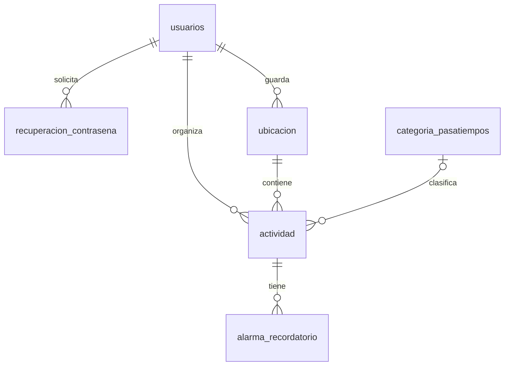

# PostgreSQL para el Planificador de Actividades

Proyecto de desarrollo basado en las seis tablas del PDF entregado. Incluye esquema, relaciones, reglas de integridad, catálogo inicial y persistencia con Docker Compose. No hace falta instalar PostgreSQL en Windows ni crear un Dockerfile: se usa su imagen oficial.

## Inicio rápido (ambos integrantes)

1. Instalar y abrir Docker Desktop con contenedores Linux.
2. Descomprimir el proyecto y abrir una terminal en esta carpeta (`planificador-db`).
3. Ejecutar en PowerShell:

```powershell
Copy-Item .env.example .env
notepad .env
docker compose up -d --wait
docker compose ps
```

Configurar `POSTGRES_PASSWORD` antes del primer arranque. La copia local que se entrega para la computadora donde se preparó el proyecto usa la clave de ejemplo, exclusivamente para desarrollo. El ZIP no incluye `.env`: cada integrante crea el suyo.

Si 5432 está ocupado, cambiar `POSTGRES_PORT=5433` en `.env` y repetir `docker compose up -d --wait`.

## Conectarse desde DBeaver, pgAdmin o el backend local

| Campo | Valor por defecto |
| --- | --- |
| Motor | PostgreSQL |
| Host | `localhost` |
| Puerto | `5432` (o `POSTGRES_PORT`) |
| Base de datos | `planificador` |
| Usuario | `planificador` |
| Contraseña | La de `.env` |
| Esquema | `public` |

También se puede abrir la consola sin instalar clientes:

```powershell
docker compose exec db sh -c 'psql -U "$POSTGRES_USER" -d "$POSTGRES_DB"'
```

En `psql`: `\dt` lista tablas, `\d actividad` muestra relaciones y restricciones, `\q` sale. Un backend agregado a la misma red de Compose usaría `db:5432` como servidor. `localhost` dentro de otro contenedor apunta a ese otro contenedor.

## Trabajar en pareja: qué se comparte

Compartir este proyecto por Git o ZIP garantiza el mismo esquema y las mismas categorías iniciales cuando el volumen es nuevo. Cada computadora mantiene su propia copia de datos: Docker no sincroniza las inserciones o modificaciones entre computadoras.

Para tener además los mismos datos en un momento concreto, uno genera un respaldo y el otro lo restaura. Para trabajar sobre los mismos datos en tiempo real se necesita una sola instancia alojada en un servidor accesible a ambos; este proyecto está configurado como desarrollo local, con el puerto ligado a `127.0.0.1`.

Versionar `compose.yaml`, `init/`, `tests/`, `scripts/`, `.env.example` y esta guía. `.env` y los respaldos quedan excluidos de Git. No compartir la carpeta de datos de Docker ni el contenedor en ejecución.

## Respaldar y compartir datos (Windows / PowerShell)

Desde esta carpeta, con el servicio iniciado:

```powershell
powershell -ExecutionPolicy Bypass -File .\scripts\backup.ps1
```

Se crea `backups/planificador-FECHA-HORA.dump`. Compartir el archivo con la pareja. Para restaurarlo, la otra persona ejecuta:

```powershell
powershell -ExecutionPolicy Bypass -File .\scripts\restore.ps1 -Archivo .\backups\planificador-FECHA-HORA.dump
```

**La restauración sustituye las tablas y sus datos en la base configurada en `.env`.** Respaldar antes si se necesita conservar información. Los scripts evitan redirecciones binarias de PowerShell para no corromper el archivo y conservan el respaldo en el formato de `pg_dump`.

## Tablas y relaciones



Todos los campos del PDF están incluidos, con nombres en minúsculas y sin tildes para facilitar consultas. Se conservan los valores de los seis enumerados. Las claves son `bigint GENERATED ALWAYS AS IDENTITY`, una de las alternativas permitidas por el PDF. Las fechas usan `timestamptz` y la sesión muestra la zona `America/Guatemala`.

Reglas implementadas:

- Correo, nombre de usuario y token únicos; `google_place_id` único global, tal como indica el PDF (se permiten varios NULL).
- Nombre de usuario inmutable mediante trigger.
- Borrado de usuario elimina sus recuperaciones, ubicaciones y actividades. Borrado de ubicación elimina actividades; borrado de actividad elimina alarmas.
- Una clave foránea compuesta impide asociar una actividad a la ubicación de otro usuario.
- Una categoría eliminada deja `id_categoria = NULL` y conserva la actividad.
- Finalización posterior al inicio, latitud entre -90 y 90, longitud entre -180 y 180, anticipación no negativa y calificación entera de 1 a 5.
- Exclusión de horarios traslapados del mismo usuario para actividades `PENDIENTE` y `REALIZADA`. Las `CANCELADA` no bloquean. Se permite que una actividad empiece exactamente cuando otra termina. `btree_gist` asegura esta regla incluso con inserciones simultáneas.
- Triggers mantienen `fecha_actualizacion` en usuarios, ubicaciones y actividades; PostgreSQL no usa la sintaxis MySQL `ON UPDATE CURRENT_TIMESTAMP`.
- Visitas cuentan actividades `REALIZADA`; promedio usa solo sus calificaciones no nulas y vale cero si no hay calificaciones. Los triggers recalculan al insertar, editar, mover o borrar una actividad; el backend debe tratar ambos campos como derivados y no editarlos directamente. Actualizaciones concurrentes sobre varios lugares pueden requerir reintentar la transacción si PostgreSQL detecta un deadlock.
- Recuperaciones registran expiración y uso, no permiten reabrir solicitudes cerradas y ofrecen `canjear_token(hash)` para un canje atómico que devuelve el usuario o NULL. El hash se almacena; el token original se envía al usuario desde el backend. El estado `EXPIRADO` se puede actualizar con un proceso del backend; el canje ya rechaza tokens vencidos aunque sigan en `PENDIENTE`.

Decisiones que el documento no fija completamente: longitudes de varchar, IDs numéricos, cascada al borrar usuario, `SET NULL` al borrar categoría, valores iniciales `PENDIENTE`, regla exacta de traslapes y promedio. El catálogo incluye seis opciones propuestas; el PDF solo cita Senderismo como ejemplo. `google_place_id` sigue siendo globalmente único: dos usuarios que quieran guardar el mismo ID de Places requerirían revisar esa regla del diseño.

El backend debe generar y verificar los hashes de contraseña (bcrypt/Argon2), autenticar usuarios, restringir consultas al propietario, exigir cambio de contraseña temporal, enviar correos y disparar alarmas. La base almacena la bandera y los estados; no ejecuta esos flujos por sí sola. El canje del token y el cambio de contraseña deben ir en la misma transacción. El clima real se consulta por API y no se almacena, como solicita el PDF. Las evaluaciones quedan en las actividades realizadas; borrar la actividad o su ubicación elimina ese historial por la cascada especificada.

## Verificar la integridad

```powershell
docker compose exec -T db sh -c 'psql -v ON_ERROR_STOP=1 -U "$POSTGRES_USER" -d "$POSTGRES_DB" -f /tests/integridad.sql'
```

Debe mostrar `NOTICE: OK: relaciones, cascadas, cache, horarios, restricciones y recuperacion` y terminar en `ROLLBACK`. Las pruebas revierten sus datos, aunque las secuencias de IDs pueden avanzar.

## Operación y cambios de esquema

```powershell
docker compose stop             # Detener conservando los datos
docker compose start            # Volver a iniciar
docker compose down             # Quitar contenedor y red; conservar volumen
docker compose up -d --wait      # Recrear usando el volumen existente
docker compose logs --tail 100 db
```

Los archivos `init/*.sql` se ejecutan **solo cuando el volumen está vacío**. Editarlos y reiniciar no actualiza una base existente. Después de empezar a trabajar, compartan migraciones SQL y ejecútenlas en ambas copias; hagan respaldos antes de cambios importantes. Cambiar la contraseña en `.env` tampoco cambia la contraseña de un usuario ya creado: se modifica desde PostgreSQL.

Solo para reiniciar desde cero y perder los datos locales deliberadamente:

```powershell
docker compose down --volumes
docker compose up -d --wait
```

La imagen queda fijada por digest después de la validación para que ambos descarguen la misma versión. Las credenciales de este entorno tienen permisos administrativos para desarrollo; un despliegue debe usar roles de aplicación separados.

Referencias oficiales: [inicialización de la imagen PostgreSQL](https://github.com/docker-library/docs/blob/master/postgres/README.md), [restricciones de exclusión y rangos](https://www.postgresql.org/docs/17/rangetypes.html).
